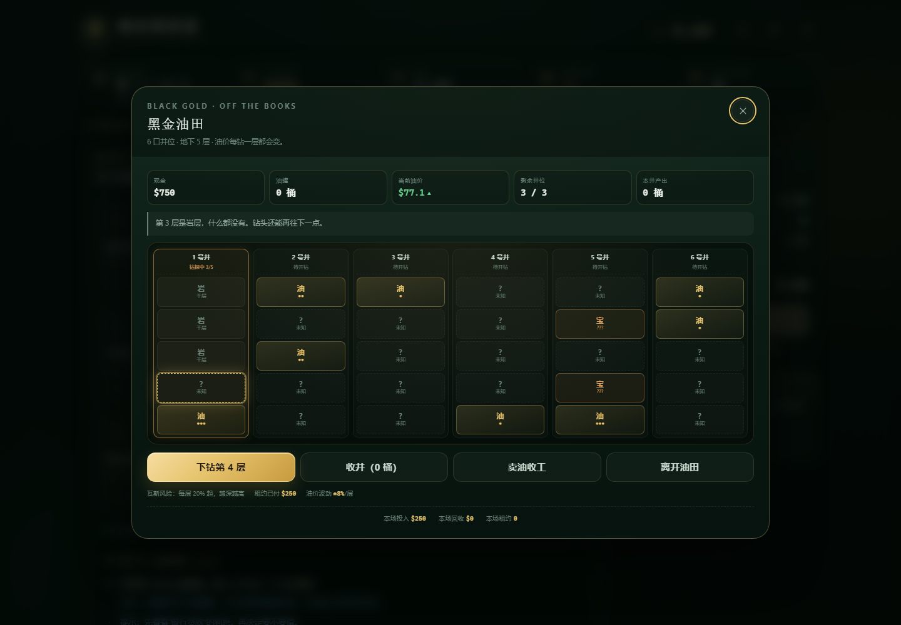
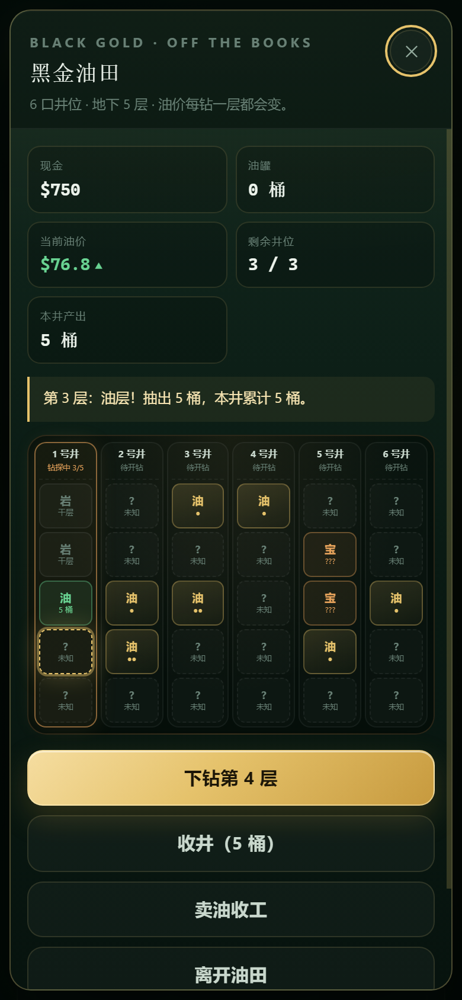
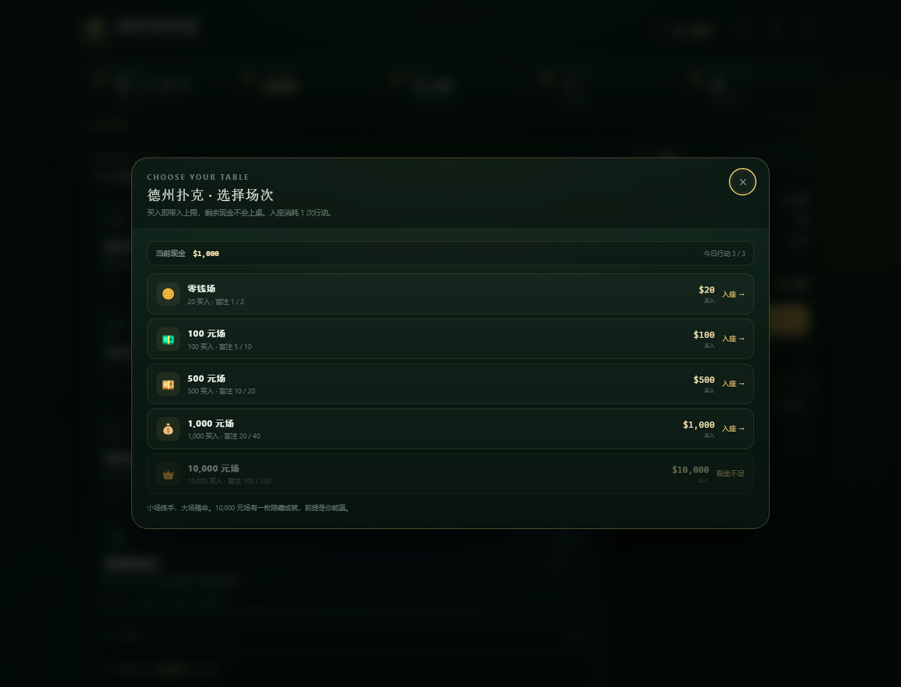
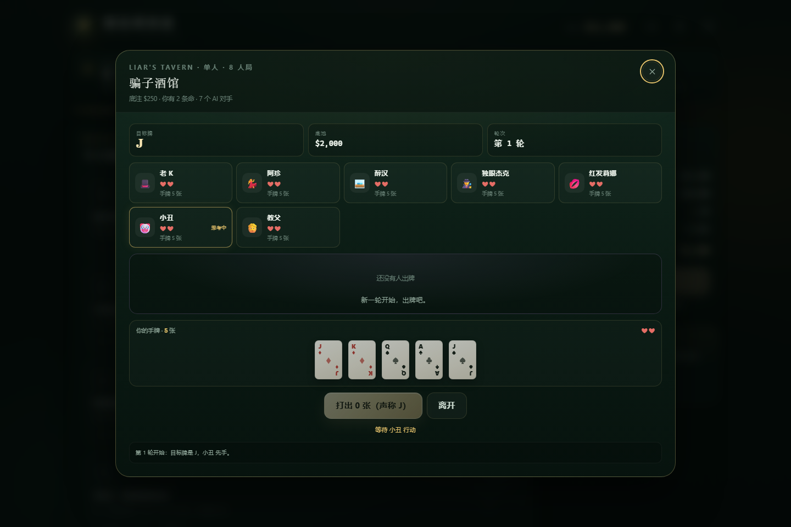
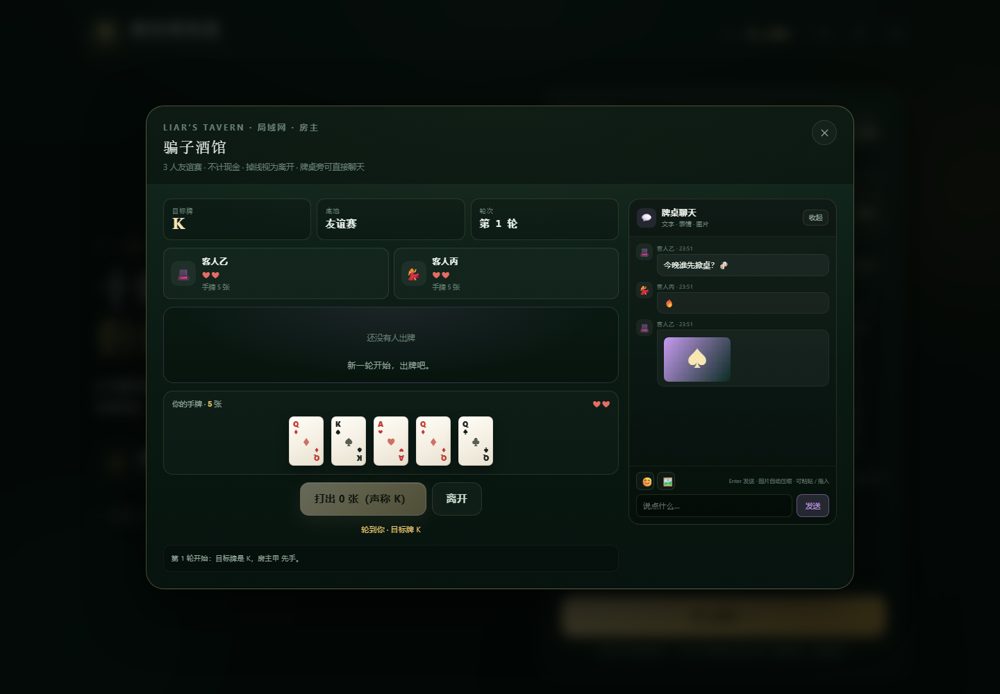
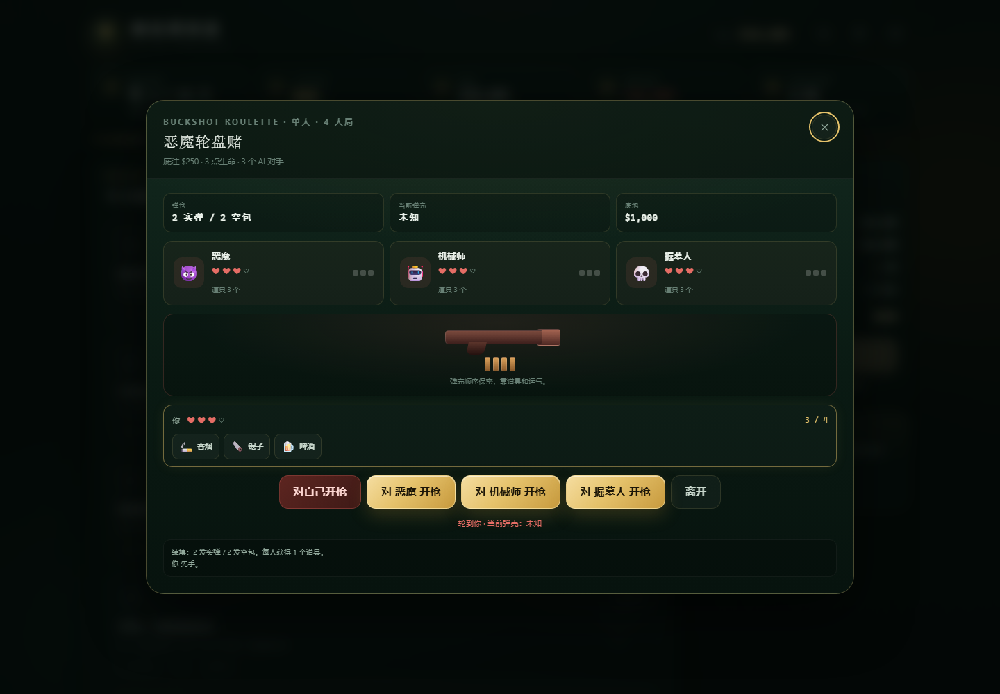
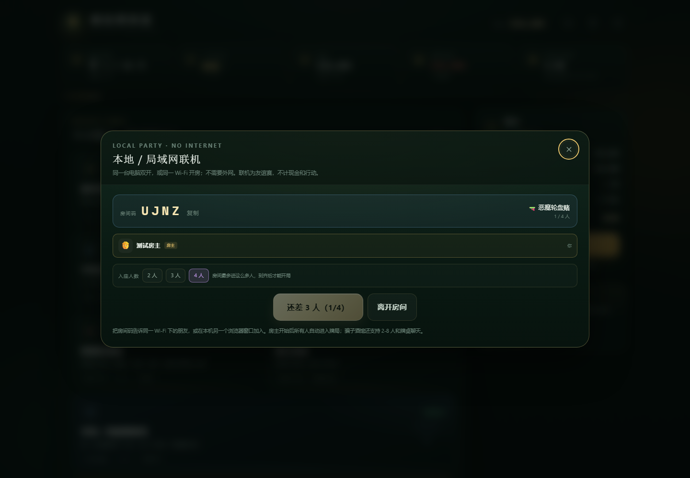

# 赌徒模拟器 · Casino Simulator

一个纯前端的赌场模拟小游戏：德州扑克（多场次）、斗地主、赌石、高利贷、骗子酒馆、恶魔轮盘赌、一张藏在赌场地底的隐藏牌桌——**黑金油田**，以及一套支持局域网联机的房间系统。

原 `my.html` 已拆分，**入口是 [`index.html`](index.html)**。单人模式完全离线，双击就能玩；本地双开 / 局域网联机可双击 [`start-lan.bat`](start-lan.bat) 启动内置服务器（优先 Python，无需 Node，也不需要外网）。

> 旧地址 `my.html` 现在会自动跳转到 `index.html`；原始单文件版本备份在 [`legacy/my.original.html`](legacy/my.original.html)。


---

## 隐藏牌桌 · 黑金油田

赌场地下还有一层。老荷官只肯透露：**对着牌桌敲出 `oil`（三个字母），或者连点页脚那排花色七次**。

解锁后会多出一张油井卡：花 $250 租一块 6 × 5 的油田，油层和遗物一开始就标在地质图上，`?` 则可能是岩层，也可能是瓦斯。每次下钻都会推动油价，撞上瓦斯会烧掉本井全部原油并赔上修井费。三口井用完、或主动“卖油收工”，就按当时的油价结算——像《石油大亨 / Turmoil》一样，赌的不只是地下有什么，还有你什么时候收手。





隐藏牌桌有自己的成就：钻井执照、第一桶黑金、井喷富翁、黑金大亨、地心之油、干井纪念、井喷现场。`钻井执照` 在成就墙里显示为 `???`，直到你第一次下井。

---

## 新牌桌

### 德州扑克 · 多场次

入座前先选场次：零钱场（$20）、100 元场、500 元场、1,000 元场、10,000 元场。买入就是带上桌的筹码，剩余现金留在账上；盲注随场次放大。10,000 元场赢下一手会解锁隐藏成就「万元桌的客人」。



### 骗子酒馆

**2-8 人，自定义人数**，每人 2 条命、5 张手牌。牌堆只发 **J / Q / K / A**，外加 **2 张万能牌**；万能牌可以当作任意目标牌，人数多时会自动加牌堆。每轮随机目标牌，你可以老实出牌，也可以把烂牌说成目标牌；下一位玩家可以选择继续出牌或“质疑”上一手。质疑后只翻开最后一手：真的，质疑者掉命；假的，出牌者掉命。最后活着的人赢。

**回响模式**：开局可选 1-3 张回响。每轮桌上会出现对应数量的公开目标牌，你可以带 1 张进自己的出牌（计入 3 张上限）。回响用完后本轮不再补充，下一轮重新出现。

单人可以选 2-8 人局（其余座位由 AI 补齐）；本地 / 局域网也支持 2-8 人，房主在房间里选人数。**牌桌聊天**：联机时牌桌旁自带聊天栏，可以发文字、表情和本机图片，图片会在浏览器里自动压缩后再通过局域网中继。联机结束后房主可以直接“同房间再来一局”，不用重新建房或加入。





### 恶魔轮盘赌

**2-4 人，自定义人数**，每人 3 点生命。每轮装填数量公开、顺序保密的实弹与空包。轮到你时先使用道具，再朝自己或任意一名活着的对手开枪：空包打自己保留回合，实弹打自己掉血。淘汰所有对手、最后活着的人赢。道具包括香烟、放大镜、啤酒、手铐和锯子。

单人可选 2-4 人局（其余座位由 AI 补齐）；局域网也支持 2-4 人，房主在房间里选人数。



### 本地 / 局域网联机（Windows，无需外网）

单人模式不需要服务器：直接双击 [`index.html`](index.html) 即可离线游玩，所有资源都在本地。

想在本机双开、或同一 Wi-Fi 下和朋友联机：

1. 双击项目根目录的 [`start-lan.bat`](start-lan.bat)。
2. Windows 防火墙弹窗选择“允许访问”（只需专用网络）。
3. 终端会打印：
   - 本机：`http://localhost:8787`
   - 局域网：`http://192.168.x.x:8787`
4. 本机双开：在两个浏览器窗口都打开 `http://localhost:8787`，一个创建房间，另一个输入房间码加入。
5. 同一 Wi-Fi：把局域网地址发给朋友，大家打开同一个地址，用房间码加入。
6. 房主选「骗子酒馆」或「恶魔轮盘赌」并开始。骗子酒馆可以选 2-8 人，牌桌旁能发文字、表情和图片；恶魔轮盘赌可选 2-4 人。

`start-lan.bat` 会优先使用 Python（`py -3` 或 `python`），没有 Python 再尝试 Node。手动启动也可以：

```bat
py -3 server/lan-server.py
```

或：

```bat
node server/lan-server.js
```

**完全不需要外网**：只要电脑本地能运行服务器，本机双开就能玩；两台设备联机需要一个局域网（路由器/热点），不要求路由器能上网。

> 直接双击 `index.html` 只能玩单人模式；联机接口必须通过 `start-lan.bat` 或服务器打开。联机是友谊赛，不计现金和行动。



### 新增隐藏成就

`万元桌的客人`、`一滴血都没掉`、`回响不绝`、`最后一枪`、`锯短了`、`局域网来客`、`局域网之王`、`开房的人`——未解锁时在成就墙只显示 `???`。

---

## 运行

直接用浏览器打开 [`index.html`](index.html) 即可离线游玩。

- 所有脚本都是普通 `<script>`，没有 ES Module 的 `file://` 限制。
- 所有美术资源都在本地 `assets/`，断网也能正常显示。
- 历史最佳净资产和音效开关使用 `localStorage`，在 `file://` 下若被浏览器禁用会自动降级，不影响游戏。
- 想本机双开 / 局域网联机时，双击 [`start-lan.bat`](start-lan.bat)，再用 `http://localhost:8787` 或终端打印的局域网地址打开。

如果你想用普通静态服务器（只能单人）：

```bash
python -m http.server 8080
# 然后打开 http://localhost:8080
```

---

## 文件结构

```text
赌徒模拟器/
├─ index.html                  # 主程序 / 全部界面结构
├─ start-lan.bat               # Windows 一键启动本地 / 局域网服务器
├─ my.html                     # 旧地址跳转页
├─ css/
│  └─ style.css               # 全部样式、响应式、动画
├─ js/
│  ├─ data.js                 # 卡牌/难度/原石/贷款/油田/成就等配置
│  ├─ core.js                 # 工具函数、牌堆、音效、localStorage
│  ├─ state.js                # 游戏状态、贷款计算、日结算、成就
│  ├─ poker-engine.js         # 德州牌力评估、蒙特卡洛胜率
│  ├─ doudizhu-rules.js       # 斗地主牌型、比较、AI 出牌
│  ├─ ui.js                   # HUD、播报、弹层、卡牌组件、难度对照表
│  ├─ poker.js                # 单挑德州扑克控制器
│  ├─ stone.js               # 赌石
│  ├─ doudizhu.js             # 斗地主
│  ├─ loans.js                # 银行贷款面板
│  ├─ oil.js                  # 隐藏牌桌「黑金油田」
│  ├─ liar.js                 # 骗子酒馆（单人 / 联机）
│  ├─ roulette.js             # 恶魔轮盘赌（单人 / 联机）
│  ├─ net.js                  # 局域网客户端（轮询 / 消息中继）
│  ├─ chat.js                 # 牌桌聊天（文字 / 表情 / 图片压缩与发送）
│  ├─ lan.js                  # 局域网大厅（创建 / 加入房间）
│  └─ main.js                 # 开始界面、日程循环、结局、初始化
├─ server/
│  ├─ lan-server.py           # Python 标准库服务器（Windows 推荐，无需 Node）
│  └─ lan-server.js           # 零依赖 Node 服务器（备选）
├─ assets/                    # 全部本地 SVG 插画（含油田井架）
├─ tests/
│  ├─ logic.test.js           # 纯逻辑测试（Node）
│  ├─ browser.test.js         # 无头 Chrome 点击冒烟测试
│  ├─ lan-server.test.js      # 局域网房间 / 人数 / 聊天接口测试（Node）
│  └─ lan-browser.test.js     # 三人联机 + 文字 / 表情 / 图片聊天浏览器测试
├─ screenshots/               # 界面截图
└─ legacy/
   └─ my.original.html        # 拆分前的原始文件
```

---

## 本轮新增

### 1. 隐藏牌桌「黑金油田」

- **解锁**：在牌桌敲出 `oil`，或连点页脚 `♠ ♥ ♣ ♦` 七次。解锁会写入 `localStorage`，之后每局牌桌底部都会出现油井卡。
- **进入**：首次发现的那次进入不消耗行动（租金照付）；之后每次进入消耗 1 次行动，租金 $250，需要至少 $250 现金。
- **地质图**：6 口井位 × 5 层。油层按规模标成 `● / ●● / ●●●`，遗物标成「宝」，`?` 在下钻时才判定岩层或瓦斯。
- **下钻**：点井口顶层开始，逐层向下。每钻一层油价随机波动；越深，瓦斯风险越高。
- **瓦斯井喷**：本井已抽出的原油全部烧掉，并按深度赔修井费。难度越高，赔得越多。
- **收手**：随时“收井”把本井产出存进油罐；“卖油收工”按当前油价结算整罐油；3 口井用完会自动结算。
- **再租一块**：结算后可继续租地，不再消耗行动，只花租金。
- 开发预览：`index.html?dev=oil`。

### 2. 成就系统扩充

- 7 个油田成就：`钻井执照`、`第一桶黑金`、`井喷富翁`、`黑金大亨`、`地心之油`、`干井纪念`、`井喷现场`。
- 2 个难度成就：`硬骨头`（困难或以上净值转正）、`地狱归来`（地狱难度净值转正）。
- `钻井执照` 是隐藏成就：未解锁时在成就墙只显示 `???`。
- 右上角新增奖杯按钮，可随时查看本局成就；结算页成就墙也会同步隐藏成就的遮罩。

### 3. 让难度差异更明显

难度不再只影响赌石爆率和 AI，而是直接改变每天的行动次数、贷款利率，以及隐藏油田的油层、深度、瓦斯和油价：

| 项目 | 简单 | 普通 | 困难 | 地狱 |
| --- | --- | --- | --- | --- |
| 每日行动 | 4 次 | 3 次 | 3 次 | 2 次 |
| 贷款利率 | ×0.8 | ×1.0 | ×1.2 | ×1.4 |
| 赌石爆率 | ×1.5 | ×1.0 | ×0.75 | ×0.55 |
| 赌石赔付 | ×1.0 | ×1.0 | ×1.3 | ×1.8 |
| 牌桌 AI | 85% | 100% | 115% | 130% |
| 油田瓦斯 / 层 | 14% | 20% | 28% | 36% |
| 油田油价 | ×1.08 | ×1.0 | ×0.9 | ×0.8 |

开始界面新增「难度差异」对照表，选中的难度会整列高亮；贷款面板、玩法说明和油田面板里的数字也都会跟着当前难度变化。

### 4. 新牌桌与局域网

- **德州扑克场次**：新增零钱 / 100 / 500 / 1,000 / 10,000 五档，买入和盲注同步放大；结算时只把桌上的筹码收回现金。
- **骗子酒馆**：新增 2-8 人吹牛/质疑牌桌，牌堆限定 J-A + 两张万能牌，支持回响模式（1-3 张公开回响）、单人 2-8 人（AI 补位）和本地 / 局域网 2-8 人；联机支持同房间再来一局。
- **牌桌聊天**：联机骗子酒馆右侧新增聊天栏，支持文字、48 个常用表情和本机图片；图片自动缩放到 560px 内并压缩，经服务器中继，不进存档、不发外网。
- **恶魔轮盘赌**：新增 2-4 人实弹/空包牌桌，含香烟、放大镜、啤酒、手铐、锯子五种道具，支持单人 2-4 人（AI 补位）和局域网 2-4 人；淘汰所有对手后获胜。
- **本地 / 局域网联机**：`start-lan.bat` 优先用 Python 标准库服务器（`server/lan-server.py`），没有 Python 时回退到 Node 版；静态文件 + 内存房间 + HTTP 轮询消息中继，房主权威结算，私密手牌/弹仓按玩家单独下发。本机双开和同一 Wi-Fi 联机都不需要外网。
- **新隐藏成就**：万元桌、酒馆满血、轮盘最后一枪、锯子双倍、局域网来客/之王/房主。
- 联机牌局为友谊赛，不扣现金和行动；单人牌局照常消耗 1 行动与底注。

---

## 这次改了什么

### 1. 文件拆分

| 原文件 | 现在 |
| --- | --- |
| `my.html` 内联 `<style>` | [`css/style.css`](css/style.css) |
| `my.html` 内联 `<script>` | [`js/`](js/) 下 17 个职责清晰的模块 + `server/` 局域网服务 |
| HTML 结构 | [`index.html`](index.html) |
| 无图片 | [`assets/`](assets/) 下本地 SVG 插画 |

### 2. Bug 修复（重点）

- **破产后游戏卡死**：原 `endDay()` 在资不抵债时直接 `return`，结局永远不会触发。现在催收失败会直接进入破产结局。
- **贷款利息算错**：原到期利息硬编码为 3 天，7 天 / 15 天贷款也按 3 天算；提前还款也硬编码 `3 - daysLeft`。现在每笔贷款记录自己的期限，利息按“本金 × 日利率 × 已过天数”计算，到期按完整期限结算。
- **贷款“总欠款”只显示一天利息**：现在显示当前本金 + 已产生利息，提前结清金额和到期应还金额分别计算。
- **重开一局后银行按钮仍被禁用**：原 `updateUI()` 只在破产分支禁用 `btnLoan`，却从不恢复。现在统一根据 `gameOver / isBankrupt / inMinigame` 重算所有按钮。
- **赌石“继续”重复扣行动**：原提示说“不消耗额外行动”，但 `startStone()` 每次都会再扣 1 次。现在进入赌石只扣一次，场内连续切只花钱。
- **斗地主把 2 当最小牌**：原牌值直接用了 `2` 的数值，导致顺子、对子比较全错。现在 2 = 15，小王 = 16，大王 = 17，与斗地主规则一致。
- **斗地主三带一比较错**：原 `canBeat()` 用整手牌最大值比较，`333+4` 会被 `444+3` 错判。现在比较三张的主牌值。
- **斗地主结算错误**：原农民赢时净收益为 0，地主输赢倍率也不对。现在按“地主双倍 / 农民单倍”结算，赢了加分、输了扣分。
- **斗地主 AI 偷看地主手牌**：原开局把 AI 地主的牌打印到播报里，现在不泄露。
- **德州扑克 AI 加注后玩家没机会回应**：原代码在 AI 加注后直接进入摊牌。现在重写为完整的单挑无限注德州：翻牌前 / 翻牌 / 转牌 / 河牌四轮下注，过牌、跟注、加注、弃牌、全下都可用。
- **德州扑克名不副实**：原“德州扑克”其实按 21 点算两张牌的大小，没有公共牌。现在是 7 选 5 的真正牌型比较。
- **AI 蒙特卡洛重复发已知牌**：模拟牌堆是新建的，原代码按 `uid` 排除已知牌会失效；现在按花色 + 点数排除。
- **日志占位符残留**：首条消息后“牌桌还没开张”会一直留在顶部，现在会自动移除。
- **结束日 / 破产 / 结局的状态不同步**：现在日结算、贷款到期、破产、结局统一走同一套状态机。
- **中途关闭牌局**：扑克和斗地主都会先确认；扑克视为弃牌，斗地主视为认输，不会悄悄吞掉筹码。
- **重复点击 / 多桌并行**：`inMinigame` 锁 + `busy` 锁，避免一局没结束又开一局。

### 3. 画面和体验

- 重做整套视觉：深绿赌桌、金色描边、玻璃面板、发光筹码、衬线标题。
- 全部牌面、扑克桌、斗地主牌桌、赌石原石、翡翠、Logo 都是本地 SVG，风格统一且离线可用。
- 德州扑克现在有完整的座位、底池、公共牌、下注筹码、当前牌型和摊牌对比。
- 赌石加入了切割动画、扫描线、切涨 / 切垮两套结果画面、单刀盈亏、本次投入 / 回收统计。
- 斗地主支持选牌抬起、提示、不出、出牌按钮，AI 思考动画，结束后亮出三家手牌。
- 响应式布局：桌面 1440、平板、手机 390 宽都做了适配。
- 用自定义弹窗替代 `confirm()` / `prompt()`，支持 Esc 关闭和键盘焦点。
- 右上角可切换合成音效（WebAudio，无外部音频文件）。
- 开始界面有难度 / 天数选择、历史最佳、玩法说明。
- 结局页显示最终盈亏（扣除 $1,000 本金）、净资产、单刀最大、牌局胜场和完整成就墙。

---

## 玩法速览

- 初始资金 **$1,000**，在 **7 / 15 / 30 天**内经营。每天行动次数随难度变化：简单 4 次、普通 / 困难 3 次、地狱 2 次。
- **德州扑克**：先选场次（$20 / $100 / $500 / $1,000 / $10,000 买入），单挑庄家，盲注随场次放大，消耗 1 行动。
- **赌石**：进入消耗 1 行动，之后连续切只花钱。四档原石，难度影响爆率和赔付上限。
- **斗地主**：三人局，底注 $100，需要至少 $200。地主双倍、农民单倍。
- **骗子酒馆**：底注 $250，2-8 人自定义人数吹牛/质疑，牌堆 J-A + 两张万能牌；可选回响模式（1-3 张回响），最后活着的人拿走底池的 90%；单人 2-8 人（AI 补位），也可本地 / 局域网 2-8 人；联机牌桌旁可发文字、表情和图片，联机可同房间再来一局。
- **恶魔轮盘赌**：底注 $250，2-4 人实弹/空包 + 道具；单人可选 2-4 人（AI 补位），也可局域网 2-4 人对赌，最后活着的人赢。
- **银行贷款**：不消耗行动；基准 3 天 5% / 天、7 天 7% / 天、15 天 10% / 天，再乘难度利率系数（0.8 / 1.0 / 1.2 / 1.4）。
- **隐藏油田**：解锁后进入消耗 1 行动，租金 $250；6 口井位、5 层地层、3 口可钻，逐层下钻赌油价和瓦斯。
- **本地 / 局域网联机**：双击 `start-lan.bat`，本机双开用 `http://localhost:8787`，同一 Wi-Fi 用终端打印的局域网地址；不需要外网，联机为友谊赛，不计现金和行动。
- 每天结束自动扣除到期贷款本息；现金不足直接破产。
- 倒计时归零时按 **净资产 = 现金 − 贷款本息** 结算结局。

---

## 数值调整

所有概率、价格、赔率、贷款方案、油田参数、成就定义都在 [`js/data.js`](js/data.js) 里。

- 普通难度下赌石期望值为负（庄家优势），简单难度更高爆率，困难 / 地狱更刺激。
- 贷款日息 5% 起，借得越久越贵；难度系数会让高难度下的利息明显更重。
- 油田的油层数量、埋藏深度、瓦斯率、油价波动和修井费都由难度配置：简单浅层富油，地狱油少、气多、价低、修井贵。
- 扑克场次、酒馆底注/命数/人数上限、轮盘初始生命/道具池/人数上限都在 [`js/data.js`](js/data.js) 的 `POKER_LEVELS`、`LIAR`、`ROULETTE` 中；聊天的文字长度、图片尺寸/质量、表情列表在 `CHAT` 中。
- 发牌、AI 决策、油田地质和联机房间都由随机性驱动，所以同一局不会完全复现。

---

## 测试

纯逻辑测试（牌力、斗地主牌型、AI 出牌合法性、贷款/日结算、难度参数、油田生成/瓦斯/油价/修井费、扑克场次、骗子酒馆规则、恶魔轮盘赌规则、聊天内容校验）：

```bash
node tests/logic.test.js
```

局域网服务器接口测试（房间容量、房主配置同步、聊天中继与图片校验）：

```bash
node tests/lan-server.test.js
```

默认测 Node 版；想测 Python 版，先设置环境变量再运行（Windows PowerShell）：

```powershell
$env:LAN_SERVER='python'; $env:PYTHON='py'; node tests/lan-server.test.js
```

浏览器冒烟测试需要 Chrome / Edge 以远程调试端口启动，然后运行：

```bash
chrome --headless=new --remote-debugging-port=9222 --user-data-dir=./.chrome-test http://localhost:8080/index.html
node tests/browser.test.js
```

三人联机 + 聊天浏览器测试（需要同一调试端口和一个已启动的服务器）：

```bash
node server/lan-server.js
# 另一个终端：Edge / Chrome 打开 http://localhost:8787/index.html 并开启 9222 调试端口
node tests/lan-browser.test.js
```

测试会覆盖：开局、难度对照表、玩法弹窗、赌石切涨/切垮、斗地主若干回合、德州选场/完整一手、贷款、隐藏油田解锁/下钻/卖油、骗子酒馆 8 人入座/认输、恶魔轮盘赌 4 人入座/认输、成就面板、结束一天、结局和重开；逻辑测试另外覆盖 J-A 牌堆、万能牌、回响牌、8 人牌堆、自定义人数、4 人轮盘淘汰和聊天内容校验；联机测试覆盖房间人数上限（骗子酒馆 8 人 / 轮盘赌 4 人）、配置同步、文字 / 表情 / 图片聊天和出牌同步。

手动验收：双击 `start-lan.bat`（或运行 `py -3 server/lan-server.py` / `node server/lan-server.js`），打开两个以上浏览器窗口，创建 / 加入房间，房主选 3-8 人开一局骗子酒馆，或选 2-4 人开一局恶魔轮盘赌，确认人数、回合和结算同步；骗子酒馆还可以发文字、表情和图片。整个过程不需要外网。

---

## 免责声明

本游戏为纯模拟娱乐，不涉及任何真实金钱交易，也没有任何充值入口。

**赌博有害，请勿模仿。**

## 制作人
- ruis_bule_cat
- YuyiChumo
