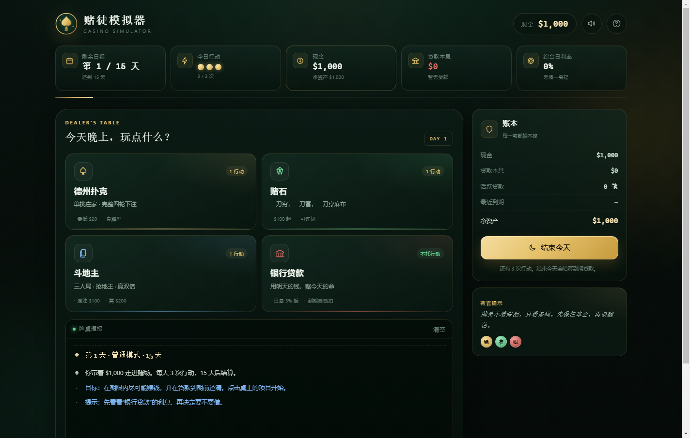

# 赌徒模拟器 · Casino Simulator

一个纯前端的赌场模拟小游戏：德州扑克、斗地主、赌石、高利贷、一套会把你逼到墙角的日结算系统，以及一张藏在赌场地底的隐藏牌桌——**黑金油田**。

原 `my.html` 已拆分，**入口是 [`index.html`](index.html)**。不需要后端、不需要安装依赖，双击就能玩。

> 旧地址 `my.html` 现在会自动跳转到 `index.html`；原始单文件版本备份在 [`legacy/my.original.html`](legacy/my.original.html)。



---

## 隐藏牌桌 · 黑金油田

赌场地下还有一层。老荷官只肯透露：**对着牌桌敲出 `oil`（三个字母），或者连点页脚那排花色七次**。

解锁后会多出一张油井卡：花 $250 租一块 6 × 5 的油田，油层和遗物一开始就标在地质图上，`?` 则可能是岩层，也可能是瓦斯。每次下钻都会推动油价，撞上瓦斯会烧掉本井全部原油并赔上修井费。三口井用完、或主动“卖油收工”，就按当时的油价结算——像《石油大亨 / Turmoil》一样，赌的不只是地下有什么，还有你什么时候收手。


隐藏牌桌有自己的成就：钻井执照、第一桶黑金、井喷富翁、黑金大亨、地心之油、干井纪念、井喷现场。`钻井执照` 在成就墙里显示为 `???`，直到你第一次下井。

---

## 运行

直接用浏览器打开 [`index.html`](index.html) 即可。

- 所有脚本都是普通 `<script>`，没有 ES Module 的 `file://` 限制。
- 所有美术资源都在本地 `assets/`，断网也能正常显示。
- 历史最佳净资产和音效开关使用 `localStorage`，在 `file://` 下若被浏览器禁用会自动降级，不影响游戏。

如果你想用本地服务器：

```bash
python -m http.server 8080
# 然后打开 http://localhost:8080
```

---

## 文件结构

```text
赌徒模拟器/
├─ index.html                  # 主程序 / 全部界面结构
├─ my.html                     # 旧地址跳转页
├─ css/
│  └─ style.css               # 全部样式、响应式、动画
├─ js/
│  ├─ data.js                 # 卡牌/难度/原石/贷款/油田/成就等配置
│  ├─ core.js                 # 工具函数、牌堆、音效、localStorage
│  ├─ state.js                # 游戏状态、贷款计算、日结算、成就
│  ├─ poker-engine.js         # 德州牌力评估、蒙特卡洛胜率
│  ├─ doudizhu-rules.js       # 斗地主牌型、比较、AI 出牌
│  ├─ ui.js                   # HUD、播报、弹层、卡牌组件、难度对照表
│  ├─ poker.js                # 单挑德州扑克控制器
│  ├─ stone.js               # 赌石
│  ├─ doudizhu.js             # 斗地主
│  ├─ loans.js                # 银行贷款面板
│  ├─ oil.js                  # 隐藏牌桌「黑金油田」
│  └─ main.js                 # 开始界面、日程循环、结局、初始化
├─ assets/                    # 全部本地 SVG 插画（含油田井架）
├─ tests/
│  ├─ logic.test.js           # 纯逻辑测试（Node）
│  └─ browser.test.js         # 无头 Chrome 点击冒烟测试
├─ screenshots/               # 界面截图
└─ legacy/
   └─ my.original.html        # 拆分前的原始文件
```

---

## 本轮新增

### 1. 隐藏牌桌「黑金油田」

- **解锁**：在牌桌敲出 `oil`，或连点页脚 `♠ ♥ ♣ ♦` 七次。解锁会写入 `localStorage`，之后每局牌桌底部都会出现油井卡。
- **进入**：首次发现的那次进入不消耗行动（租金照付）；之后每次进入消耗 1 次行动，租金 $250，需要至少 $250 现金。
- **地质图**：6 口井位 × 5 层。油层按规模标成 `● / ●● / ●●●`，遗物标成「宝」，`?` 在下钻时才判定岩层或瓦斯。
- **下钻**：点井口顶层开始，逐层向下。每钻一层油价随机波动；越深，瓦斯风险越高。
- **瓦斯井喷**：本井已抽出的原油全部烧掉，并按深度赔修井费。难度越高，赔得越多。
- **收手**：随时“收井”把本井产出存进油罐；“卖油收工”按当前油价结算整罐油；3 口井用完会自动结算。
- **再租一块**：结算后可继续租地，不再消耗行动，只花租金。
- 开发预览：`index.html?dev=oil`。

### 2. 成就系统扩充

- 7 个油田成就：`钻井执照`、`第一桶黑金`、`井喷富翁`、`黑金大亨`、`地心之油`、`干井纪念`、`井喷现场`。
- 2 个难度成就：`硬骨头`（困难或以上净值转正）、`地狱归来`（地狱难度净值转正）。
- `钻井执照` 是隐藏成就：未解锁时在成就墙只显示 `???`。
- 右上角新增奖杯按钮，可随时查看本局成就；结算页成就墙也会同步隐藏成就的遮罩。

### 3. 让难度差异更明显

难度不再只影响赌石爆率和 AI，而是直接改变每天的行动次数、贷款利率，以及隐藏油田的油层、深度、瓦斯和油价：

| 项目 | 简单 | 普通 | 困难 | 地狱 |
| --- | --- | --- | --- | --- |
| 每日行动 | 4 次 | 3 次 | 3 次 | 2 次 |
| 贷款利率 | ×0.8 | ×1.0 | ×1.2 | ×1.4 |
| 赌石爆率 | ×1.5 | ×1.0 | ×0.75 | ×0.55 |
| 赌石赔付 | ×1.0 | ×1.0 | ×1.3 | ×1.8 |
| 牌桌 AI | 85% | 100% | 115% | 130% |
| 油田瓦斯 / 层 | 14% | 20% | 28% | 36% |
| 油田油价 | ×1.08 | ×1.0 | ×0.9 | ×0.8 |

开始界面新增「难度差异」对照表，选中的难度会整列高亮；贷款面板、玩法说明和油田面板里的数字也都会跟着当前难度变化。

---

## 这次改了什么

### 1. 文件拆分

| 原文件 | 现在 |
| --- | --- |
| `my.html` 内联 `<style>` | [`css/style.css`](css/style.css) |
| `my.html` 内联 `<script>` | [`js/`](js/) 下 12 个职责清晰的模块 |
| HTML 结构 | [`index.html`](index.html) |
| 无图片 | [`assets/`](assets/) 下本地 SVG 插画 |

### 2. Bug 修复（重点）

- **破产后游戏卡死**：原 `endDay()` 在资不抵债时直接 `return`，结局永远不会触发。现在催收失败会直接进入破产结局。
- **贷款利息算错**：原到期利息硬编码为 3 天，7 天 / 15 天贷款也按 3 天算；提前还款也硬编码 `3 - daysLeft`。现在每笔贷款记录自己的期限，利息按“本金 × 日利率 × 已过天数”计算，到期按完整期限结算。
- **贷款“总欠款”只显示一天利息**：现在显示当前本金 + 已产生利息，提前结清金额和到期应还金额分别计算。
- **重开一局后银行按钮仍被禁用**：原 `updateUI()` 只在破产分支禁用 `btnLoan`，却从不恢复。现在统一根据 `gameOver / isBankrupt / inMinigame` 重算所有按钮。
- **赌石“继续”重复扣行动**：原提示说“不消耗额外行动”，但 `startStone()` 每次都会再扣 1 次。现在进入赌石只扣一次，场内连续切只花钱。
- **斗地主把 2 当最小牌**：原牌值直接用了 `2` 的数值，导致顺子、对子比较全错。现在 2 = 15，小王 = 16，大王 = 17，与斗地主规则一致。
- **斗地主三带一比较错**：原 `canBeat()` 用整手牌最大值比较，`333+4` 会被 `444+3` 错判。现在比较三张的主牌值。
- **斗地主结算错误**：原农民赢时净收益为 0，地主输赢倍率也不对。现在按“地主双倍 / 农民单倍”结算，赢了加分、输了扣分。
- **斗地主 AI 偷看地主手牌**：原开局把 AI 地主的牌打印到播报里，现在不泄露。
- **德州扑克 AI 加注后玩家没机会回应**：原代码在 AI 加注后直接进入摊牌。现在重写为完整的单挑无限注德州：翻牌前 / 翻牌 / 转牌 / 河牌四轮下注，过牌、跟注、加注、弃牌、全下都可用。
- **德州扑克名不副实**：原“德州扑克”其实按 21 点算两张牌的大小，没有公共牌。现在是 7 选 5 的真正牌型比较。
- **AI 蒙特卡洛重复发已知牌**：模拟牌堆是新建的，原代码按 `uid` 排除已知牌会失效；现在按花色 + 点数排除。
- **日志占位符残留**：首条消息后“牌桌还没开张”会一直留在顶部，现在会自动移除。
- **结束日 / 破产 / 结局的状态不同步**：现在日结算、贷款到期、破产、结局统一走同一套状态机。
- **中途关闭牌局**：扑克和斗地主都会先确认；扑克视为弃牌，斗地主视为认输，不会悄悄吞掉筹码。
- **重复点击 / 多桌并行**：`inMinigame` 锁 + `busy` 锁，避免一局没结束又开一局。

### 3. 画面和体验

- 重做整套视觉：深绿赌桌、金色描边、玻璃面板、发光筹码、衬线标题。
- 全部牌面、扑克桌、斗地主牌桌、赌石原石、翡翠、Logo 都是本地 SVG，风格统一且离线可用。
- 德州扑克现在有完整的座位、底池、公共牌、下注筹码、当前牌型和摊牌对比。
- 赌石加入了切割动画、扫描线、切涨 / 切垮两套结果画面、单刀盈亏、本次投入 / 回收统计。
- 斗地主支持选牌抬起、提示、不出、出牌按钮，AI 思考动画，结束后亮出三家手牌。
- 响应式布局：桌面 1440、平板、手机 390 宽都做了适配。
- 用自定义弹窗替代 `confirm()` / `prompt()`，支持 Esc 关闭和键盘焦点。
- 右上角可切换合成音效（WebAudio，无外部音频文件）。
- 开始界面有难度 / 天数选择、历史最佳、玩法说明。
- 结局页显示最终盈亏（扣除 $1,000 本金）、净资产、单刀最大、牌局胜场和完整成就墙。

---

## 玩法速览

- 初始资金 **$1,000**，在 **7 / 15 / 30 天**内经营。每天行动次数随难度变化：简单 4 次、普通 / 困难 3 次、地狱 2 次。
- **德州扑克**：单挑庄家，盲注 $10 / $20，消耗 1 行动。最低 $20 入场。
- **赌石**：进入消耗 1 行动，之后连续切只花钱。四档原石，难度影响爆率和赔付上限。
- **斗地主**：三人局，底注 $100，需要至少 $200。地主双倍、农民单倍。
- **银行贷款**：不消耗行动；基准 3 天 5% / 天、7 天 7% / 天、15 天 10% / 天，再乘难度利率系数（0.8 / 1.0 / 1.2 / 1.4）。
- **隐藏油田**：解锁后进入消耗 1 行动，租金 $250；6 口井位、5 层地层、3 口可钻，逐层下钻赌油价和瓦斯。
- 每天结束自动扣除到期贷款本息；现金不足直接破产。
- 倒计时归零时按 **净资产 = 现金 − 贷款本息** 结算结局。

---

## 数值调整

所有概率、价格、赔率、贷款方案、油田参数、成就定义都在 [`js/data.js`](js/data.js) 里。

- 普通难度下赌石期望值为负（庄家优势），简单难度更高爆率，困难 / 地狱更刺激。
- 贷款日息 5% 起，借得越久越贵；难度系数会让高难度下的利息明显更重。
- 油田的油层数量、埋藏深度、瓦斯率、油价波动和修井费都由难度配置：简单浅层富油，地狱油少、气多、价低、修井贵。
- 发牌、AI 决策和油田地质都包含随机性，所以同一局不会完全复现。

---

## 测试

纯逻辑测试（牌力、斗地主牌型、AI 出牌合法性、贷款/日结算、难度参数、油田生成/瓦斯/油价/修井费）：

```bash
node tests/logic.test.js
```

浏览器冒烟测试需要 Chrome 以远程调试端口启动，然后运行：

```bash
chrome --headless=new --remote-debugging-port=9222 --user-data-dir=./.chrome-test http://localhost:8080/index.html
node tests/browser.test.js
```

测试会覆盖：开局、难度对照表、玩法弹窗、赌石切涨/切垮、斗地主若干回合、德州完整一手、贷款、隐藏油田解锁/下钻/卖油、成就面板、结束一天、结局和重开。

---

## 免责声明

本游戏为纯模拟娱乐，不涉及任何真实金钱交易，也没有任何充值入口。

**赌博有害，请勿模仿。**
